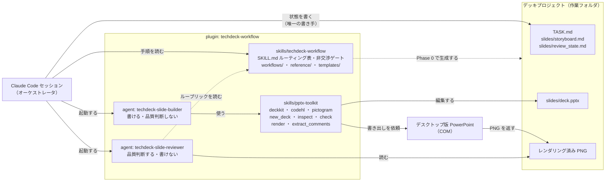
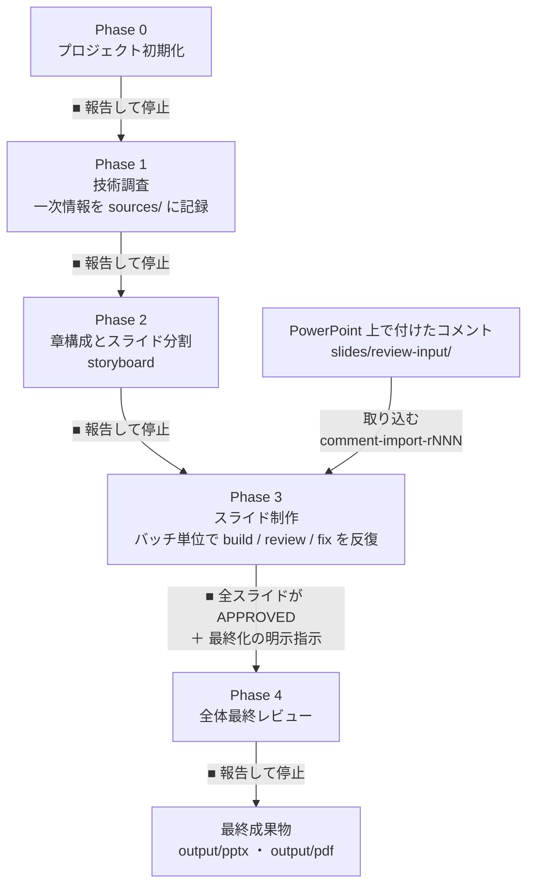
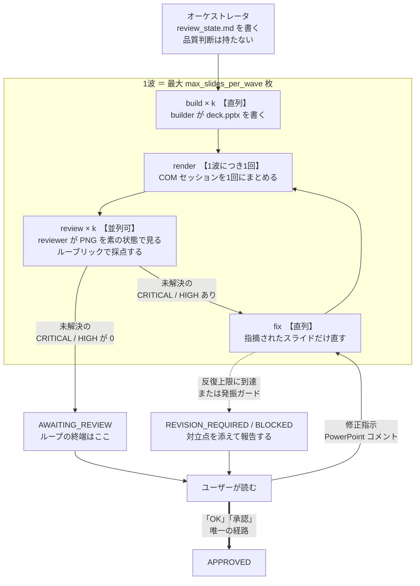

# techdeck-workflow

**話者なしで、読者が資料単体で技術内容を理解できる**スライド（PPTX）を作るための、
Claude Code 用スキル / エージェント一式。

口頭補足を前提とした「発表用スライド」ではなく、**手元で読んで完結する技術解説資料**を
対象にしている。したがって「1スライド1メッセージ」「文字は少なく」といった一般的な
プレゼン作法とは、意図的に逆を行く箇所がある。

## 何が入っているか



PPTX の読み書きは `pptx-toolkit` に一本化されており、**PNG / PDF の書き出しだけが
デスクトップ版 PowerPoint（COM）を通る。** この一点が [Requirements](#requirements) の
制約のほぼすべての理由になっている。

| | 種別 | 役割 |
| --- | --- | --- |
| `skills/techdeck-workflow` | Skill | 調査 → 構成 → 制作 → 最終レビューの4フェーズ・ワークフロー本体 |
| `skills/pptx-toolkit` | Skill | python-pptx + 生 OOXML による PPTX の生成・編集・検査・レンダリング・コメント抽出 |
| `agents/techdeck-slide-builder.md` | Agent | 指示されたスライドだけを作る／直す。承認はしない |
| `agents/techdeck-slide-reviewer.md` | Agent | レンダリング済み PNG を先に見て批判的にレビューする。読み取り専用 |

この2つのエージェントがどう噛み合うかは [制作ループの仕組み](#制作ループの仕組み)。

## Requirements

* **Windows**（`pptx-toolkit` は Windows 前提）
* **デスクトップ版 Microsoft PowerPoint** — PNG / PDF 書き出しは PowerPoint COM 経由のみ。
  **LibreOffice フォールバックは無い。** PowerPoint が無い環境でも編集・検査はできるが、
  レンダリングできないためレビューループは実質回らない。
* **Python 3.10 以上**（3.13.5 で検証）
* Python パッケージ:

  ```
  pip install python-pptx pywin32 pypdfium2
  ```

  | パッケージ | 必要な範囲 |
  | --- | --- |
  | `python-pptx` | 必須（1.0.2 で検証）。`lxml` は依存として入る |
  | `pywin32` | `render_deck.py` の PNG / PDF 書き出しのみ |
  | `pypdfium2` | `render_deck.py --from-pdf` のみ |

* 日本語スライドを作る場合、プロファイル既定の **Yu Gothic**（`dark`/`light` プリセット）が
  入っていること。別のフォントを使うなら `slides/deck-profile.json` の `fonts.cjk` を差し替える。

## インストール

### A. プラグインとして入れる（推奨）

このリポジトリはプラグイン構成（`.claude-plugin/plugin.json`）になっている。
マーケットプレース経由で追加すると、2スキルと2エージェントが同時に入り、
**配置ミスが起きない。**

```
/plugin marketplace add <このリポジトリのURL または ローカルパス>
/plugin install techdeck-workflow
```

### B. 手動でコピーする

ユーザー全体で使う場合:

```
skills/pptx-toolkit        →  ~/.claude/skills/pptx-toolkit
skills/techdeck-workflow   →  ~/.claude/skills/techdeck-workflow
agents/*.md                →  ~/.claude/agents/
```

特定プロジェクトだけで使う場合は `~/.claude/` を `<project>/.claude/` に読み替える。

**手動コピー時の必須条件2つ:**

1. **2つのスキルは同じ `skills/` の直下に兄弟として置く。**
   `techdeck-workflow/scripts/init_project.py` が `pptx-toolkit` を兄弟ディレクトリとして
   解決する。別の場所に置くなら `init_project.py --pptx-toolkit <dir>` で明示すること。
2. **エージェント2本を置いたら Claude Code を再起動する。**
   `agents/` はセッション開始時に読み込まれるため、起動中にコピーしても認識されない。

インストール後の確認:

```
/plugin      （プラグイン形式の場合）
```
または新しいセッションで「techdeck-workflow スキルは使えますか」と聞く。

## 使い方

空のフォルダで Claude Code を開き、作りたい資料を伝えるだけでよい。
`TASK.md` が無ければ自動的に **Phase 0（プロジェクト初期化）** に入る。

```
「Kotlin のコルーチンについて、読者が単体で理解できる技術解説資料を作りたい」
```



**■ の箇所では必ず報告して止まる。** フェーズは自動で進まず、ユーザーが明示的に
次へ進めるまで待つ。Phase 0 は `TASK.md`・ディレクトリ構成・`deck-profile.json`・
タイトルスライド入りの `slides/deck.pptx` を作った時点で停止する。

| フェーズ | 主な成果物 |
| --- | --- |
| Phase 0 | `TASK.md`, `AGENTS.md`, ディレクトリ構成, `slides/deck-profile.json`, 空の `slides/deck.pptx` |
| Phase 1 | `sources/source_index.md`, `notes/findings.md`, `notes/open_questions.md`, `notes/glossary.md` |
| Phase 2 | `slides/outline.md`, `slides/storyboard.md`, `slides/review_state.md` |
| Phase 3 | `slides/deck.pptx` の各スライド, `slides/reviews/slide-NNN.md`, `assets/diagrams/`, `examples/` |
| Phase 4 | `output/pptx/`, `output/pdf/` |

## 制作ループの仕組み

Phase 3 は、スライドを**バッチ**（既定は次の1章分）でまとめて作る。作った各スライドは、
ユーザーに渡す前に **build → render → review → fix** のループを通る。



ループの合格バーは「未解決の `CRITICAL` / `HIGH` が 0」で、Phase 4 の最終化基準と同一。
**それを満たしてもスライドの終端は `AWAITING_REVIEW`** であって `APPROVED` ではない。
評価用エージェントが返す `PASS` はレビュー総合判定であり、スライド状態とは別の名前空間である。

### 誰が何をできるか

| | `deck.pptx` を書く | 品質を判断する | `review_state.md` を書く |
| --- | --- | --- | --- |
| オーケストレータ（メインの会話） | しない | **しない** | **する（唯一の書き手）** |
| `techdeck-slide-builder` | **する（唯一の書き手）** | しない | しない |
| `techdeck-slide-reviewer` | 読むだけ | **する** | 書けない（Write / Edit を持たない） |

**判断を持つエージェントは書けず、書けるエージェントは判断を持たない。**
評価用エージェントにはビルダーの言い分を渡さない。新しい文脈で、レンダリング済みの PNG と
storyboard と一次情報だけを見せて採点させる。これは自己レビューが構造的に持てない独立性である。

### 直列と並列は、性能ではなく正しさの制約

* **build と fix は常に直列。** `slides/deck.pptx` は1ファイルで、python-pptx はパッケージ
  全体を読み込み、メモリ上で変更し、全体を書き戻す。同時に走らせると**後勝ちでスライドが
  無言で消える。**
* **レンダリングも直列。** PowerPoint COM は起動中のインスタンスに接続するため、
  同時実行すると先に終わった方の `app.Quit()` が他方の書き出しを殺す。
* **1波のレンダリングは1回の COM セッションにまとめる。**
  `render_deck.py <deck> --slides 31-37 --png-dir <out>` のように範囲でまとめて叩く。
  8枚 × 3反復なら、1枚ずつ起動して24回のところが3回で済む。
* **並列化してよいのはレビューだけ。** レビュアーは PNG とテキストしか読まない。

### ループが打ち切られるとき

反復上限に達しても指摘が残る場合、あるいは同じ指摘が2回続いた場合（発振ガード）は、
ループを打ち切る。同じ指摘が2回続くのは実行の問題ではなく仕様の問題なので、
**レビュアーの指摘とビルダーの反論を両方そのまま**添えてユーザーに判断を委ねる。
技術的に誤っていると分かっているスライドは `BLOCKED` にして、ユーザーのレビューには回さない。

### PowerPoint コメントの取り込み

PowerPoint 上で付けたコメントを取り込んで直させることもできる。`extract_comments.py` が
`ppt/comments/modernComment_*.xml` を掘って、スライド番号とアンカー図形に対応付ける。
コメント付きのファイルは `slides/review-input/` に**読み取り専用の原本**として退避され、
ラウンド番号（`rNNN`）で管理される。

## 設計上の制約（意図的なもの）

* **スライドを消さずに分割する。** 情報量が多すぎる場合の既定の解決策は削除ではなく分割。
* **エージェントは自分の成果物を承認できない。** 承認は必ず人間が行う。
* **技術的に誤ったフィードバックには根拠を挙げて反論する。** 言われた通りに直すだけではない。
* **十分性は文字数ではない。** 散文を図・表・ピクトグラムに移すのは削除ではなく表現の変更。

## ドキュメント中のプレースホルダ

| 表記 | 意味 |
| --- | --- |
| `<pptx-toolkit>` | `pptx-toolkit` スキルの実際の設置ディレクトリ |
| `<project>` | デッキプロジェクトのルート |
| `<TOOLKIT>` | `<pptx-toolkit>/scripts` の絶対パス（エージェントへの受け渡し用） |

プラグインとして入れた場合、`<pptx-toolkit>` は `${CLAUDE_PLUGIN_ROOT}/skills/pptx-toolkit`。

## 言語について

スキル本体のドキュメント・ワークフロー・レビュールーブリック・生成されるテンプレートは
**日本語主体**（ルール文の一部は英語）。生成される資料も既定で日本語。
`deck-profile.json` の `language` と `TASK.md` で変更できるが、
ルーブリックの日本語組版ルール（禁則処理、和文フォント指定など）は日本語資料向けに書かれている。

## ライセンス

TODO: 公開前に決めること。
